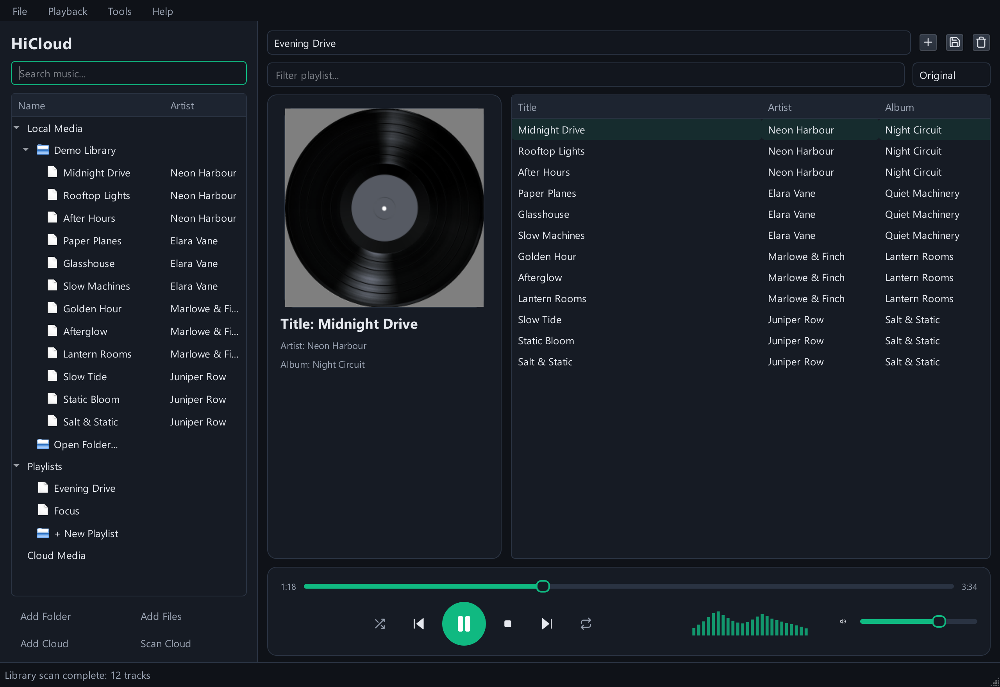
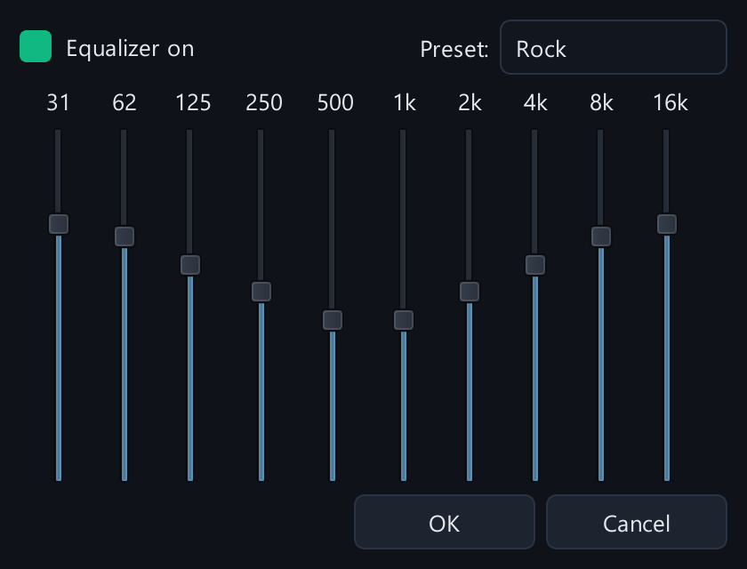

<p align="center">
  
</p>

<h1 align="center">HiCloud MP</h1>

<p align="center">
  <strong>Your music, local and cloud, in one quiet player.</strong><br>
  A friendly Windows music player with a real 10-band equalizer,
  playlists, cover art and a remote for your phone.
</p>

<p align="center">
  <a href="https://github.com/PhantomPixelDev/HiCloudMP/releases/latest/download/HiCloudMP-Setup.exe"></a>
  <a href="https://github.com/PhantomPixelDev/HiCloudMP/releases/latest/download/HiCloudMP-portable.zip"></a>
  <a href="https://github.com/PhantomPixelDev/HiCloudMP/releases/latest/download/HiCloudMP-macOS.dmg"></a>
  <a href="https://github.com/PhantomPixelDev/HiCloudMP/releases/latest/download/HiCloudMP-linux-x86_64.AppImage"></a>
</p>

<p align="center">
  <sub>Windows 10 / 11 &nbsp;·&nbsp; free and open source (MIT) &nbsp;·&nbsp; no account, no telemetry</sub>
</p>



## Download

Both buttons always download the newest release — no version hunting.

| | |
|---|---|
| **Installer** <br><sub>recommended</sub> | [**HiCloudMP-Setup.exe**](https://github.com/PhantomPixelDev/HiCloudMP/releases/latest/download/HiCloudMP-Setup.exe) — about 75 MB. Adds HiCloud MP to the Start menu and installs an uninstaller. No Python or extra codecs needed. |
| **Portable** | [**HiCloudMP-portable.zip**](https://github.com/PhantomPixelDev/HiCloudMP/releases/latest/download/HiCloudMP-portable.zip) — about 112 MB. Unzip it anywhere, run `HiCloudMP.exe`, and take your player with you. |
| **macOS (Apple Silicon)** | [**HiCloudMP-macOS.dmg**](https://github.com/PhantomPixelDev/HiCloudMP/releases/latest/download/HiCloudMP-macOS.dmg) — ad-hoc signed, not notarized yet; see the first-launch notes below. |
| **Linux x86_64** | [**HiCloudMP-linux-x86_64.AppImage**](https://github.com/PhantomPixelDev/HiCloudMP/releases/latest/download/HiCloudMP-linux-x86_64.AppImage) — runs on most distributions; libfuse2 needed for direct double-click. |
| **Linux / macOS portable** | HiCloudMP-\<version\>-linux-x86_64.tar.gz and HiCloudMP-\<version\>-macos-arm64.dmg ship as versioned files on every release. |

> **First launch and SmartScreen.** The app isn't code-signed yet, so Windows
> may show *"Windows protected your PC"*. Click **More info → Run anyway** —
> the builds come straight from this repository's GitHub Actions.
>
> Want release notes or an older version? See
> [all releases](https://github.com/PhantomPixelDev/HiCloudMP/releases).

## First launch notes by platform

**macOS (Apple Silicon only).** Builds are ad-hoc signed but not notarized
yet (notarization requires a paid Apple Developer account), so macOS may warn
*"HiCloudMP can't be opened"* or *"can't verify the developer"*. Either:

- **Right-click** `HiCloudMP.app` in the mounted DMG and choose **Open**, then
  confirm **Open** in the warning dialog - the one-time approval persists; or
- clear the quarantine flag entirely: run
  `xattr -dr com.apple.quarantine HiCloudMP.app` in a terminal.

x86_64 (Intel) Macs are not covered; the hosted runners for Intel macOS have
been retired by GitHub. If you need Intel builds, that becomes a paid-runner
follow-up.

**Linux (x86_64).** Every release ships an AppImage and a tarball:

- `HiCloudMP-linux-x86_64.AppImage` - make it executable once
  (`chmod +x HiCloudMP-linux-x86_64.AppImage`) and run it. Double-clicking
  directly on desktops additionally needs libfuse2
  (`sudo apt install libfuse2` on Ubuntu/Debian, `fuse2` on Arch).
- `HiCloudMP-<version>-linux-x86_64.tar.gz` - unpack anywhere and run
  `./HiCloudMP` from the folder; no fuse requirement.

## What you can do

- **Bring your library together.** Add your music folders once, then browse
  by name, artist and album — with instant search and a queue you can filter
  and sort.
- **Stream from your cloud.** Connect Nextcloud or any WebDAV server, a
  Subsonic-compatible server, or Ampache. Albums scan in the background and
  play directly — nothing to sync, nothing to download twice.
- **Shape the sound.** A real 10-band equalizer with presets and custom
  curves. Changes apply while the music plays, and flat settings are a
  bit-exact bypass.
- **Keep the queue moving.** Title / artist / album columns, drag to reorder,
  Play Next, shuffle, repeat — and the queue remembers its sort and filter
  between sessions.
- **Use your phone as the remote.** Settings → Web Remote gives you a link
  that works on the same Wi-Fi, with no app to install. It's token protected
  and stays local unless you allow other devices.
- **Stay private.** No account, no telemetry. Settings and playlists stay on
  your PC, and saved cloud passwords are encrypted with Windows DPAPI (locked
  to your Windows user).

## Get started in three steps

1. **Install** the app — or unzip the portable build.
2. **Add your music** — `Add Folder` for local files, or `Add Cloud` →
   `Scan Cloud` for a server.
3. **Press play.** `Tools → Equalizer` and `Settings → Web Remote` are one
   click away.



Works with **WebDAV** servers (Nextcloud, ownCloud), **Subsonic-compatible**
servers (Subsonic, Navidrome, Airsonic, Nextcloud Music) and
**Ampache-compatible** servers. You'll need the server address and your login;
an app password is fine.

Your data lives in `%LOCALAPPDATA%\HiCloudMP\HiCloudMP`. Installing,
upgrading or uninstalling never touches your settings, playlists or music.

## Good to know

- **Requirements:** Windows 10 or 11, 64-bit.
- **Updates:** *Settings → Check for updates* compares your version with the
  latest GitHub release.
- **Uninstall:** *Settings → Apps → HiCloud MP*. Your music and settings stay
  untouched.
- **Linux:** the source runs on Linux (with MPRIS media keys); packaged
  builds are Windows-only for now.

## For developers

<details>
<summary><strong>Run from source, tests and packaging</strong></summary>

**Run from source** (Python 3.12+):

```bash
git clone https://github.com/PhantomPixelDev/HiCloudMP.git
cd HiCloudMP
python -m venv .venv
.venv\Scripts\activate          # Windows
source .venv/bin/activate       # macOS / Linux
pip install -r requirements.txt
python main.py
```

On Linux, also install `requirements-linux.txt` (MPRIS/media keys) and the
PyGObject packages your distro needs.

**Tests** (headless/offscreen, no audio device required):

```bash
pip install -r requirements-dev.txt
.venv\Scripts\python -m pytest -q
```

**Packaging:** `.github/workflows/build.yml` builds the standalone app
with Nuitka on every platform job (Windows, Linux x86_64, macOS arm64) and
runs the test suite on Linux and macOS before burning Nuitka minutes.
Pushing a `v*` tag additionally compiles the Inno Setup installer, then a
single all-or-nothing `release` job publishes one release with
`HiCloudMP-portable.zip`, the versioned installer plus the stable
`HiCloudMP-Setup.exe` alias, the Linux AppImage + tarball, and the macOS
DMG (stable alias `HiCloudMP-macOS.dmg`) - the links used by the download
buttons above. Tags containing `rc` publish as prereleases.

**Screenshots:** `tools/make_screenshots.py` renders the real UI headlessly
against a throwaway demo library, so `screen.png` and the site images can be
regenerated after UI changes.

Contributions are welcome — keep the suite green and open a PR.

[](https://github.com/PhantomPixelDev/HiCloudMP/actions/workflows/build.yml)

</details>

## Links

[Website](https://PhantomPixelDev.github.io/HiCloudMP/) ·
[Releases](https://github.com/PhantomPixelDev/HiCloudMP/releases) ·
[Issues](https://github.com/PhantomPixelDev/HiCloudMP/issues) ·
[MIT license](LICENSE)
